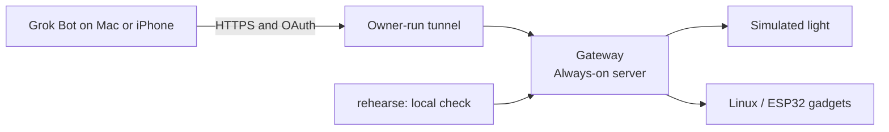

# Grok Gadgets gateway

The connection point between your Grok Bot and your gadgets: a built-in simulated light,
Linux gadgets and ESP32 devices. It serves six MCP tools. The owner tested USB and Wi-Fi hardware through the gateway.
Grok Bot calls the six tools natively from the Mac and iPhone apps through `serve --oauth` behind a tunnel you run ([record](https://github.com/adidshaft/grok-gadgets/blob/main/docs/verification/grok-remote-https-2026-10-13.md), [project status](https://grokgadgets.org/doc-docs-public-support-matrix)).
Independent project, not affiliated with SpaceXSI.

> Writing style: ASD-STE100-inspired English. Use short sentences, active verbs and one instruction per step. This is not certified compliance.

## Start here

| Path | Next step |
| --- | --- |
| [Use a gadget](https://github.com/adidshaft/grok-gadgets/blob/main/docs/getting-started/connect-grok-bot.md) | Connect Grok Bot to the tested kit |
| [Build a gadget](docs/first-success.md) | Start with a simulated light |
| [Run the gateway](docs/daily-use.md) | Keep a local gateway available |

## Install from PyPI

The package is on [PyPI](https://pypi.org/project/grok-gadgets-gateway/). Install it into a virtual
environment with Python 3.11+. It is an alpha, so name the version or pass `--pre`:

```sh
python3 -m venv .venv
.venv/bin/python -m pip install --pre grok-gadgets-gateway
.venv/bin/grok-gadgets-gateway --version
```

Each [GitHub release](https://github.com/adidshaft/grok-gadgets-gateway/releases) also has the wheel and
`SHA256SUMS`; the PyPI files are the same build.

On an Intel Mac, `cryptography` has no prebuilt wheel and needs a Rust toolchain to build.

For your first simulator test, follow [first success](docs/first-success.md).

## Quick start

For contributors: clone the source with Git and [uv](https://docs.astral.sh/uv/getting-started/installation/).

```sh
git clone https://github.com/adidshaft/grok-gadgets-gateway.git
cd grok-gadgets-gateway
uv sync --locked
uv run grok-gadgets-gateway init
uv run grok-gadgets-gateway serve --simulator
uv run grok-gadgets-gateway rehearse
```

Run `rehearse` in a second terminal while `serve` keeps running. It calls the six tools in the
order Grok Bot will: list the gadgets, set the simulated light blue, read its state. See
[first success in five minutes](docs/first-success.md).

## How it works



The gateway gives Grok Bot six tools:

| Tool | What it does |
| --- | --- |
| `gadgets_list_devices` | Lists gadgets, their commands and what each one does. Call it first. |
| `gadgets_get_state` | Reads a gadget's last reported state and how fresh it is. |
| `gadgets_command` | Sends a command and waits up to 3 seconds for the result. |
| `gadgets_command_status` | Reads the result of a slower command later. |
| `gadgets_read_events` | Reads button presses and other events in order. |
| `gadgets_diagnostics` | A support report with no tokens, state or arguments. |

A relay in accounts mode (`serve --oauth --accounts`) scopes every tool to the caller's own
gadgets and adds `gadgets_claim`, `gadgets_remove` and `gadgets_share`
([relay host guide](docs/relay-host.md#accounts-other-people-claim-their-own-gadgets)).

A result is the gadget's own report, not proof of a physical effect.

## Connect a gadget

`init` prints two settings blocks with absolute paths. Use the first when the connector starts the gateway itself (`stdio`). Use the second for a running `serve` at `http://127.0.0.1:8766/mcp`, with the bearer token from `~/.config/grok-gadgets/mcp-token`. `init --client http` prints just one.

Gadgets connect to `127.0.0.1:8765` with their own token:

```sh
uv run grok-gadgets-gateway enroll desk-lamp --token-file desk-lamp.token
```

`enroll desk-lamp --rotate` issues a new token for the same gadget. Write gadgets with the
[Linux SDK](https://github.com/adidshaft/grok-gadgets-linux-sdk) or the
[ESP32 SDK](https://github.com/adidshaft/grok-gadgets-esp32-sdk); the Linux SDK's `dev`
command needs no token at all. Both ports are loopback only.
A Wi-Fi gadget on your home network can use the opt-in TLS listener on one private
address, `serve --lan-listen`; see [Wi-Fi devices](docs/wifi-devices.md).

## Grok Bot today

The owner tested Grok Bot local commands on 12 October 2026. Grok Bot ran `rehearse` on the Mac.
Read the [connection evidence](https://github.com/adidshaft/grok-gadgets/blob/dev/docs/verification/grok-local-execution-2026-10-12.md).
On 13 October 2026 Grok Bot also called the six tools natively from the Mac and the iPhone.
It used an owner-run tunnel and `serve --oauth`, a sign-in that you approve on the Mac
([tunnel guide](docs/tunnel.md#oauth-sign-in-for-grok-bot)).
The owner tested this route for one day, including a phone call over cellular.
The original Mac route needs an awake Mac. During its sleep check, calls failed; nothing was queued.
An always-on relay now lets the kit work without the Mac. See the [relay record](https://github.com/adidshaft/grok-gadgets/blob/main/docs/verification/mac-free-route-2026-10-13.md).
Phone setup passed on iPhone and Android; Grok Bot calls from Android remain untested.
See the [phone setup record](https://github.com/adidshaft/grok-gadgets/blob/main/docs/verification/phone-setup-2026-10-14.md) and [roadmap](https://github.com/adidshaft/grok-gadgets/blob/main/ROADMAP.md).
Never expose port 8765.
Read [remote access](docs/remote-access.md) and [security](SECURITY.md) first.

## Troubleshooting

| Symptom | Next step |
| --- | --- |
| Not sure which command | Run `grok-gadgets-gateway --help`. Use `serve` for a long-running process; `stdio` is for a connector that starts the gateway itself. |
| No simulated light | Start with `--simulator`. |
| `401` from `rehearse` | Send `Authorization: Bearer <token>` with the exact contents of the token file. |
| Config rejected | Use strict v1 JSON within the [documented bounds](docs/simulator.md). |
| Command still `accepted` or `dispatched` | The gadget is slow. Poll `gadgets_command_status`; never resend with a new command ID. |

## Learn more

- [First success](docs/first-success.md) and the [simulator guide](docs/simulator.md)
- [Keep the gateway running](docs/always-on.md) as a background service, and [leave the Grok Bot route on](docs/daily-use.md).
- [Track usage](docs/usage.md): calls by token, device, capability and day, and an opt-in usage hook.
- [Local operation](docs/local-operation.md), [architecture](docs/architecture.md) and [protocol 0.1.0](protocol/0.1.0/README.md)
- Demo without HTTP: `uv run python -m grok_gadgets_gateway.demo` (uses test-only controls)
- Shared docs and the website: [hub repository](https://github.com/adidshaft/grok-gadgets) and <https://grokgadgets.org/>

## Community

Questions, build photos and ideas are welcome on
[r/GrokGadgets](https://www.reddit.com/r/GrokGadgets/). Report bugs and request features in
[GitHub Issues](https://github.com/adidshaft/grok-gadgets-gateway/issues). New here? Pick a
[good first issue](https://github.com/adidshaft/grok-gadgets-gateway/issues?q=is%3Aissue+is%3Aopen+label%3A%22good+first+issue%22)
and read [CONTRIBUTING](CONTRIBUTING.md). Get help: [SUPPORT](SUPPORT.md).
Contribute on the `dev` branch; `main` holds tagged stable releases ([branches](CONTRIBUTING.md#branches)).

## License and affiliation

Apache-2.0; see [LICENSE](LICENSE) and [NOTICE](NOTICE). Grok Gadgets is an independent
open-source project. It is **not affiliated with, endorsed by or sponsored by SpaceXSI**. We reconstructed the pre-publication commit dates; see the
[history record](https://github.com/adidshaft/grok-gadgets/blob/main/docs/verification/publication-sanitization.md).

## Project discussion

Ask questions and share gadget ideas in [hub Discussions](https://github.com/adidshaft/grok-gadgets/discussions).
Use this repository's issue forms for defects.
